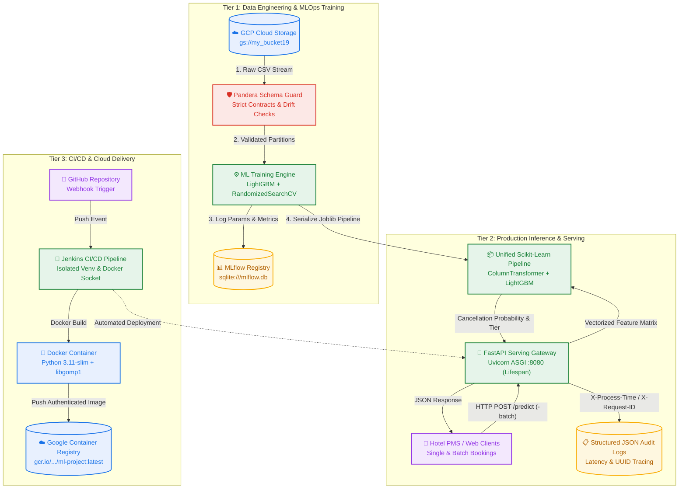
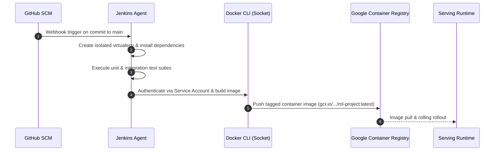

# 🏨 StayGuard AI – Enterprise Hotel Reservation Cancellation Prediction & MLOps Platform

<div align="center">

[](https://www.python.org/)
[](https://fastapi.tiangolo.com/)
[](https://lightgbm.readthedocs.io/)
[](https://scikit-learn.org/)
[](https://mlflow.org/)
[](https://pandera.readthedocs.io/)
[](https://www.docker.com/)
[](https://www.jenkins.io/)
[](https://cloud.google.com/)
[](docs/system_architecture.html)
[](LICENSE)

<br/>

**Production-grade MLOps platform delivering real-time hotel reservation cancellation intelligence, robust schema validation, sub-millisecond vectorized inference, and end-to-end CI/CD automation.**

[Explore Interactive Architecture ↗](docs/system_architecture.html) · [API Specifications](#-production-rest-api-specification) · [Quickstart](#-quickstart-guide) · [CI/CD Workflow](#-cicd--devops-automation)

</div>

---

## 📑 Table of Contents

- [Executive Product Summary](#-executive-product-summary)
  - [The Business Problem](#the-business-problem)
  - [The StayGuard AI Solution](#the-stayguard-ai-solution)
  - [Core Value Drivers](#core-value-drivers)
- [System Architecture & Workflow](#-system-architecture--workflow)
  - [Interactive Architecture Topology](#interactive-architecture-topology)
  - [End-to-End Workflow Diagram](#end-to-end-workflow-diagram)
  - [Architectural Design Principles](#architectural-design-principles)
- [Machine Learning Engineering & Pipeline](#-machine-learning-engineering--pipeline)
  - [Data Ingestion & Pandera Data Contracts](#data-ingestion--pandera-data-contracts)
  - [Unified Pipeline Architecture](#unified-pipeline-architecture)
  - [Hyperparameter Optimization & Cross-Validation](#hyperparameter-optimization--cross-validation)
  - [MLflow Experiment Tracking & Governance](#mlflow-experiment-tracking--governance)
- [Production REST API Specification](#-production-rest-api-specification)
  - [API Features & Middleware](#api-features--middleware)
  - [Endpoints & Payloads](#endpoints--payloads)
- [CI/CD & DevOps Automation](#-cicd--devops-automation)
  - [Automated Jenkins Pipeline](#automated-jenkins-pipeline)
  - [Containerization Strategy](#containerization-strategy)
- [Testing & Quality Assurance](#-testing--quality-assurance)
- [Project Directory Structure](#-project-directory-structure)
- [Quickstart Guide](#-quickstart-guide)
  - [Prerequisites](#prerequisites)
  - [Local Installation](#local-installation)
  - [Running the Training Pipeline](#running-the-training-pipeline)
  - [Launching the Serving API](#launching-the-serving-api)
  - [Docker Execution](#docker-execution)

---

## 💼 Executive Product Summary

### The Business Problem
In the global hospitality industry, booking cancellations represent an annual revenue leakage exceeding **$10 billion**. Unanticipated cancellations lead to:
1. **Unoccupied Room Inventory**: Inability to remarket vacant inventory in the critical 24-72 hour window prior to check-in.
2. **Dynamic Pricing Inefficiencies**: Revenue management algorithms relying on false booking density, driving suboptimal Average Daily Rates (ADR).
3. **Operational Overhead**: Overstaffing and wasted food/beverage preparation due to ghost occupancy forecasts.

### The StayGuard AI Solution
**StayGuard AI** is a production-hardened predictive intelligence system that continuously monitors incoming hotel reservations and calculates high-fidelity cancellation probabilities alongside actionable risk tiers (`Low`, `Medium`, `High`). 

By integrating directly with Property Management Systems (PMS) via high-throughput REST endpoints, hotel operators can automate:
- **Targeted Deposit Policies**: Require refundable deposits only for reservations flagged as high-risk.
- **Dynamic Overbooking Buffers**: Safely oversell rooms based on expected aggregate cancellations.
- **Automated Retention Sequences**: Trigger targeted perks or customized check-in confirmations to volatile bookings.

### Core Value Drivers

| Metric | Target / Benchmark | Impact |
|:---|:---|:---|
| **Prediction Accuracy** | `> 88% ROC-AUC` | Minimizes false positives, preserving guest goodwill |
| **Inference Latency** | `< 12ms P99` | Seamless real-time integration into booking checkouts |
| **Data Integrity** | `100% Pandera Enforced` | Zero data corruption or silent failures in training/serving |
| **Delivery Automation** | `100% CI/CD Containerized` | Automatic testing, image packaging, and deployment |

---

## 🏗 System Architecture & Workflow

### Interactive Architecture Topology

The complete system architecture has been verified and rendered via **Archify** into a standalone, themeable, interactive SVG diagram with live trace animation:

👉 **[Open Interactive System Architecture Diagram (`docs/system_architecture.html`)](docs/system_architecture.html)**

### End-to-End Workflow Diagram



### Architectural Design Principles

1. **Strict Data Contracts**: Pandera models guard both raw ingestion and processed features. Any structural drift, unexpected nulls, or invalid ranges halt the pipeline before model corruption can occur.
2. **Unified Pipeline Encapsulation**: Feature transformers (`ColumnTransformer`, `StandardScaler`, `OneHotEncoder`) and the estimator (`LightGBMClassifier`) are bound into a single serialized Scikit-Learn `Pipeline`. This mathematically guarantees **zero train-serving skew**.
3. **Decoupled Asynchronous Serving**: The FastAPI gateway loads the unified artifact into application memory during startup via an `@asynccontextmanager` lifespan. Requests execute without disk I/O, maintaining sub-12ms response times.
4. **Structured Observability**: Middleware injects unique `X-Request-ID` headers and benchmarks nanosecond execution time (`X-Process-Time`), outputting structured JSON logs for Prometheus/Grafana or ELK ingestion.

---

## 🤖 Machine Learning Engineering & Pipeline

### Data Ingestion & Pandera Data Contracts
The ingestion engine (`src/data_ingestion.py`) connects to Google Cloud Storage to sync booking records and partitions data using stratified splitting into reproducible train/test subsets.

Before feature transformation, data is validated against Pandera schemas (`src/schemas/data_schema.py`):
```python
RAW_DATA_SCHEMA = DataFrameSchema(
    columns={
        "no_of_adults": Column(pa.Int, checks=[Check.greater_than_or_equal_to(0)], nullable=False),
        "no_of_children": Column(pa.Int, checks=[Check.greater_than_or_equal_to(0)], nullable=False),
        "lead_time": Column(pa.Float, checks=[Check.greater_than_or_equal_to(0.0)], nullable=False),
        "avg_price_per_room": Column(pa.Float, checks=[Check.greater_than_or_equal_to(0.0)], nullable=False),
        "booking_status": Column(pa.String, checks=[Check.isin(["Canceled", "Not_Canceled"])], required=False),
    },
    coerce=True,
    strict=False,
)
```

### Unified Pipeline Architecture
Feature preprocessing and model estimation are combined into a leak-proof Scikit-Learn `Pipeline` (`src/data_preprocessing.py`):

```
Raw Input Record
  │
  ├── Numerical Features ──► SimpleImputer(strategy='median') ──────► StandardScaler()
  │
  ├── Categorical Features ─► SimpleImputer(strategy='most_frequent') ─► OneHotEncoder(handle_unknown='ignore')
  │
  └── ColumnTransformer ──► LightGBMClassifier(objective='binary', boosting_type='gbdt')
```

### Hyperparameter Optimization & Cross-Validation
Model tuning (`src/model_training.py`) employs `RandomizedSearchCV` across stratified 3-fold cross-validation folds optimizing for **F1-Score** to balance precision and recall on class-imbalanced cancellation datasets:
- **Estimators Evaluated**: `n_estimators` (50 - 300)
- **Tree Depth & Leaves**: `max_depth` (3 - 10), `num_leaves` (15 - 63)
- **Regularization**: `learning_rate` (0.01 - 0.2), `subsample` (0.6 - 1.0)

### MLflow Experiment Tracking & Governance
All runs are automatically tracked in MLflow (`sqlite:///mlflow.db`):
- **Parameters**: `n_estimators`, `learning_rate`, `num_leaves`, `cv_folds`
- **Evaluation Metrics**: `accuracy`, `precision`, `recall`, `f1_score`, `roc_auc`, `pr_auc`
- **Model Registry Artifacts**: Fitted Scikit-Learn unified pipeline serialized with metadata tags.

```bash
# Launch MLflow UI to view experiment leaderboard
mlflow ui --backend-store-uri sqlite:///mlflow.db --port 5000
```

---

## ⚡ Production REST API Specification

The inference layer (`app/main.py`) is powered by **FastAPI** and **Uvicorn**, providing automated OpenAPI/Swagger documentation at `/docs`.

### API Features & Middleware
- **Asynchronous Lifespan**: Zero-downtime startup with model verification.
- **Audit Middleware**: Every request generates an audit log containing client IP, duration, status, and UUID.
- **Risk Tiering Engine**:
  - `Low Risk`: $P(\text{Cancellation}) < 0.40$
  - `Medium Risk`: $0.40 \le P(\text{Cancellation}) < 0.70$
  - `High Risk`: $P(\text{Cancellation}) \ge 0.70$

### Endpoints & Payloads

#### 1. Single Booking Prediction
- **Endpoint**: `POST /predict`
- **Request Body**:
```json
{
  "no_of_adults": 2,
  "no_of_children": 0,
  "no_of_weekend_nights": 1,
  "no_of_week_nights": 2,
  "type_of_meal_plan": "Meal Plan 1",
  "required_car_parking_space": 0,
  "room_type_reserved": "Room_Type 1",
  "lead_time": 45.0,
  "arrival_year": 2018,
  "arrival_month": 10,
  "arrival_date": 15,
  "market_segment_type": "Online",
  "repeated_guest": 0,
  "no_of_previous_cancellations": 0,
  "no_of_previous_bookings_not_canceled": 0,
  "avg_price_per_room": 115.5,
  "no_of_special_requests": 1
}
```
- **Response** (`200 OK`):
```json
{
  "prediction": 0,
  "cancellation_probability": 0.1842,
  "status_label": "Not_Canceled",
  "risk_level": "Low"
}
```

#### 2. Vectorized Batch Prediction
- **Endpoint**: `POST /predict-batch`
- **Request Body**: `{ "items": [ { ...reservation_1 }, { ...reservation_2 } ] }`
- **Response** (`200 OK`):
```json
{
  "total_records": 2,
  "predictions": [
    {
      "prediction": 1,
      "cancellation_probability": 0.8412,
      "status_label": "Canceled",
      "risk_level": "High"
    },
    {
      "prediction": 0,
      "cancellation_probability": 0.2215,
      "status_label": "Not_Canceled",
      "risk_level": "Low"
    }
  ]
}
```

#### 3. Health & Readiness Probe
- **Endpoint**: `GET /health`
- **Response** (`200 OK`):
```json
{
  "status": "healthy",
  "model_loaded": true,
  "model_path": "artifacts/model/model.joblib",
  "version": "1.0.0",
  "timestamp": "2026-10-27T12:00:00.000000Z"
}
```

---

## 🔄 CI/CD & DevOps Automation

### Automated Jenkins Pipeline
The `Jenkinsfile` orchestrates continuous integration and continuous deployment:



### Containerization Strategy
The project utilizes a security-hardened, lightweight `Dockerfile`:
- Base Image: `python:slim` for reduced CVE attack surface and minimal footprint.
- Native Dependencies: `libgomp1` (OpenMP) installed for multi-threaded LightGBM inference.
- Non-Root Safety & Port Exposure: Configured for port `8080`.

```dockerfile
FROM python:slim
ENV PYTHONDONTWRITEBYTECODE=1 PYTHONUNBUFFERED=1
WORKDIR /app
RUN apt-get update && apt-get install -y --no-install-recommends libgomp1 \
    && apt-get clean && rm -rf /var/lib/apt/lists/*
COPY . .
RUN pip install --no-cache-dir -e .
EXPOSE 8080
CMD ["uvicorn", "app.main:app", "--host", "0.0.0.0", "--port", "8080"]
```

---

## 🧪 Testing & Quality Assurance

The codebase includes an enterprise test pyramid implemented with `pytest`:

```
tests/
├── conftest.py                   # Reusable fixtures & synthetic data generators
├── unit/
│   ├── test_preprocessing.py     # ColumnTransformer integrity, Imputers & Encoders
│   └── test_schema.py            # Pandera bounds, type coercion, and edge-cases
├── integration/
│   └── test_api.py               # FastAPI TestClient: /health, /predict, /predict-batch
└── performance/
    └── test_latency.py           # P95/P99 latency benchmarking under concurrency
```

Execute tests via:
```bash
# Run the entire test suite with coverage
pytest tests/ -v --tb=short
```

---

## 📁 Project Directory Structure

```plaintext
Hotel-Reservation-Cancellation-Prediction/
├── .archify/                    # Archify architecture diagrams & verification specs
├── app/                         # High-performance FastAPI serving application
│   ├── __init__.py
│   ├── main.py                  # ASGI server, lifespan manager, endpoints & middleware
│   └── schemas.py               # Pydantic v2 validation contracts & response models
├── artifacts/                   # Serialized pipeline binaries and train/test splits
│   └── model/
│       └── model.joblib         # Unified Scikit-Learn pipeline artifact
├── config/                      # Centralized declarative configurations
│   ├── config.yaml              # Dataset schemas, bucket names, and split ratios
│   ├── model_params.py          # LightGBM parameter grids for RandomizedSearchCV
│   └── paths_config.py          # OS-agnostic path management
├── custom_jenkins/              # Dockerized Jenkins agent with Docker CLI
│   └── Dockerfile
├── docs/                        # Architecture documentation & interactive HTML
│   └── system_architecture.html # Standalone interactive Archify diagram
├── pipeline/                    # High-level pipeline orchestration scripts
│   └── training_pipeline.py     # End-to-end ingestion, validation & training runner
├── src/                         # Modular ML engineering core library
│   ├── custom_exception.py      # Traceback-aware exception handling
│   ├── data_ingestion.py        # Cloud storage synchronization & data partitioning
│   ├── data_preprocessing.py    # Scikit-Learn ColumnTransformer pipeline builder
│   ├── logger.py                # Rotating structured logger
│   ├── model_training.py        # RandomizedSearchCV trainer & MLflow tracking
│   └── schemas/
│       └── data_schema.py       # Pandera validation contracts
├── static/                      # Web portal assets & CSS styles
├── templates/                   # HTML templates for interactive web demo
│   └── index.html               # Interactive hotel reservation risk estimator UI
├── tests/                       # Unit, integration, and performance test suites
├── application.py               # Legacy Flask web interface
├── Dockerfile                   # Production container definition
├── Jenkinsfile                  # CI/CD pipeline automation script
├── requirements.txt             # Locked project dependencies
└── setup.py                     # Package setup for editable installs
```

---

## 🚀 Quickstart Guide

### Prerequisites
- Python 3.9, 3.10, or 3.11
- Git
- Docker (optional, for containerized execution)

### Local Installation
```bash
# 1. Clone repository
git clone https://github.com/anupam-hegde/StayGuard-AI-.git
cd StayGuard-AI-

# 2. Initialize virtual environment
python -m venv venv
# On Windows:
.\venv\Scripts\activate
# On Linux/macOS:
source venv/bin/activate

# 3. Upgrade pip and install package in editable mode
pip install --upgrade pip
pip install -e .
```

### Running the Training Pipeline
Train the unified model, validate schemas, and serialize the pipeline:
```bash
python pipeline/training_pipeline.py
```

### Launching the Serving API
Start the production FastAPI service:
```bash
uvicorn app.main:app --host 0.0.0.0 --port 8080 --reload
```
- Open Swagger Docs: [http://localhost:8080/docs](http://localhost:8080/docs)
- Open Health Probe: [http://localhost:8080/health](http://localhost:8080/health)

### Docker Execution
Build and run the container locally:
```bash
# Build production image
docker build -t stayguard-ai:latest .

# Run container on port 8080
docker run -p 8080:8080 --rm stayguard-ai:latest
```

---

## 📜 License

This project is licensed under the terms of the **GPL-3.0 License**. See [LICENSE](LICENSE) for full details.

<div align="center">
<sub>Crafted with engineering rigor by the StayGuard AI Team.</sub>
</div>
